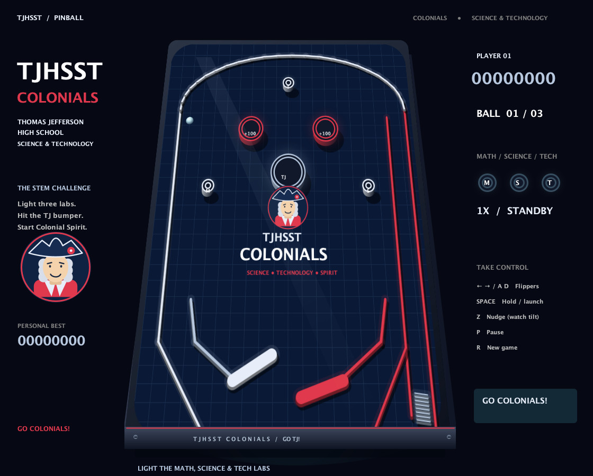
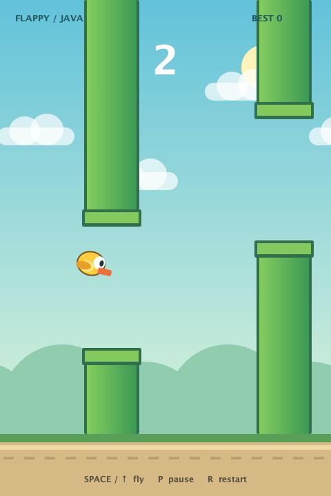
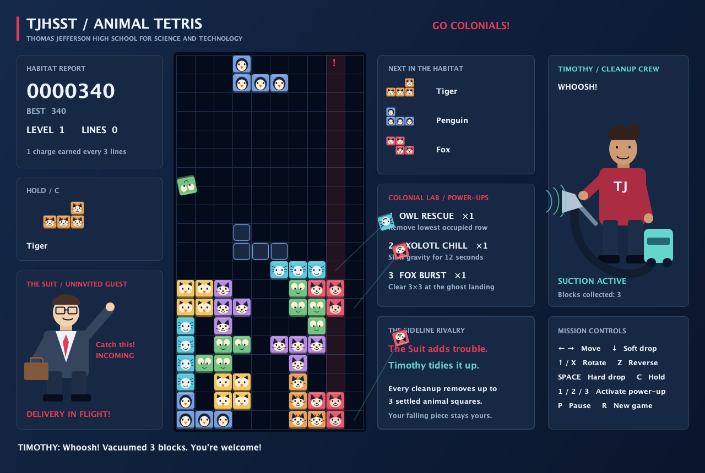
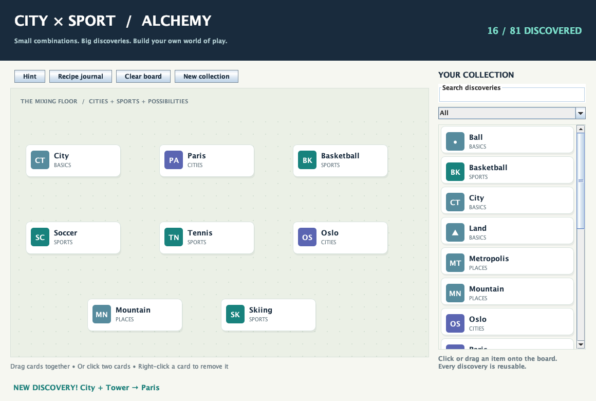
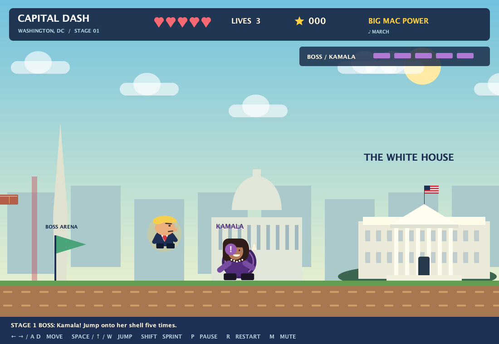

# Java Arcade Collection

Five standalone Java Swing games built in the same IntelliJ project. Requires
**JDK 17 or newer**; no external libraries, assets, or build tools are needed.

| Game | Launch class | Description |
| --- | --- | --- |
| TJHSST Colonials Pinball | `pinball.Main` | School-themed pinball with a Colonial mascot |
| Flappy Bird | `flappybird.Main` | Tap-to-fly obstacle game |
| TJHSST Animal Tetris | `tetris.Main` | Animal blocks, power-ups, and animated characters |
| City × Sport Alchemy | `alchemy.Main` | Discover cities, sports, and events by combining cards |
| Capital Dash | `capitaldash.Main` | Washington, DC cartoon platformer with synthesized music |

## Game screenshots

Screenshots captured directly from the games’ Swing/Java2D rendering. Click a screenshot to open its launcher.

<table>
  <tr>
    <td align="center"><a href="src/pinball/Main.java"></a><br><strong>TJHSST Colonials Pinball</strong></td>
    <td align="center"><a href="src/flappybird/Main.java"></a><br><strong>Flappy Bird</strong></td>
  </tr>
  <tr>
    <td align="center"><a href="src/tetris/Main.java"></a><br><strong>TJHSST Animal Tetris</strong></td>
    <td align="center"><a href="src/alchemy/Main.java"></a><br><strong>City × Sport Alchemy</strong></td>
  </tr>
  <tr>
    <td colspan="2" align="center"><a href="src/capitaldash/Main.java"></a><br><strong>Capital Dash</strong></td>
  </tr>
</table>

Capture details and refresh instructions are in [docs/covers](docs/covers/README.md).
These are the games’ own rendered pixels, with no generated artwork or added overlays.

## Run a game

Open the project in IntelliJ and run the corresponding `Main.java`, or compile
all games from the project root:

```sh
javac --release 17 -d out src/*/*.java
java -cp out capitaldash.Main
```

Replace `capitaldash.Main` with any launch class above. Compilation output and
personal saves are excluded from Git. Controls and details for each game follow.

To run all dependency-free checks:

```sh
javac --release 17 -d out src/*/*.java test/*/*.java
java -Djava.awt.headless=true -cp out pinball.PinballCheck
java -Djava.awt.headless=true -cp out flappybird.FlappyCheck
java -Djava.awt.headless=true -cp out tetris.TetrisCheck
java -Djava.awt.headless=true -cp out alchemy.AlchemyCheck
java -Djava.awt.headless=true -cp out capitaldash.DashCheck
```

## Coding style

All Java source and tests use K&R-style braces: opening braces stay on the same
line, including `} else {` and `} catch (...) {`, with four-space indentation and
consistent spacing. `.editorconfig` carries the indentation and IntelliJ brace
settings for future edits.

Formatting uses google-java-format 2.0.0 in AOSP mode (four spaces). To reproduce
or check the format, download its official `google-java-format-2.0.0-all-deps.jar`
from [the release page](https://github.com/google/google-java-format/releases/tag/v2.0.0)
and run:

```sh
java -jar /path/to/google-java-format-2.0.0-all-deps.jar --aosp --cleanup=false --skip-sorting-imports --skip-removing-unused-imports --skip-reflowing-long-strings --skip-reordering-modifiers --replace src/*/*.java test/*/*.java
```

Replace `--replace` with `--dry-run --set-exit-if-changed` to check formatting
without changing files. The formatter is only a development tool; the games
still require just a JDK to compile and run.

---

## TJHSST Colonials — Pinball

A Thomas Jefferson High School for Science and Technology themed Java pinball game with navy, red, and white artwork, an original Colonial mascot illustration, animated bumpers, chrome ball, particle bursts, spring launcher, moving flippers, and synthesized arcade sounds. No external libraries or assets. Requires JDK 17+.

The mascot name follows the [school website](https://tjhsst.fcps.edu/); the artwork is an original illustration, not the official school logo. Existing personal bests are retained.

## Play

In IntelliJ, open the project and run `src/pinball/Main.java`.

Or, from this folder:

```sh
javac --release 17 -d out src/pinball/*.java
java -cp out pinball.Main
```

- **Left / Right** or **A / D**: flippers
- **Hold Space, then release**: charge and launch
- **Z**: nudge; repeated nudges cause tilt and disable flippers temporarily
- **P**: pause / resume
- **R**: restart
- **M**: mute / unmute

Light the Math (M), Science (S), and Technology (T) labs, then hit the TJ bumper to trigger 20 seconds of triple-score Colonial Spirit. Each run has three balls and one early ball save per ball. Personal bests save to `.neon-reactor-best` in the working directory after a completed run. Audio gracefully disables if no output device is available.

Physics advances at 240 fixed steps per second. The window resizes while retaining table proportions. Losing window focus pauses play; press P to resume.

## Code structure

`Main` only creates the application window. The game is organized by responsibility:

| Class | Responsibility |
| --- | --- |
| `GameState` | Ball position, flipper angles, score, timers, and run status |
| `GameModel` | Run lifecycle, launch, objectives, scoring, and tilt |
| `PhysicsEngine` | Movement, drag, rail contacts, bumper rebounds, and flipper collisions |
| `TableLayout` | Bumper and target geometry in table coordinates |
| `Particle` | Spark movement and lifetime |
| `GameControls` | Keyboard bindings, repeat handling, and focus loss |
| `GameLoop` | Fixed 240 Hz simulation and frame scheduling |
| `PinballPanel` | Swing lifecycle, window scaling, and composing the views |
| `PlayfieldRenderer` | Playfield artwork and moving objects |
| `TableView` | Perspective projection, cabinet, and glass |
| `HudRenderer` | Branding, score, instructions, and overlays |
| `ArcadeGraphics` | Shared palette and drawing primitives |
| `SchoolBranding` | Original vector Colonial mascot artwork |
| `ScoreStore` | Loading and saving personal bests |
| `Sound` | Synthesized arcade audio |

The model and physics run without a window. All mutable gameplay and rendering run on Swing's event thread; audio uses its own worker. Renderers read state without advancing the simulation. Each panel owns its render buffers and starts/stops its loop when attached/detached.

## Regression checks

```sh
javac --release 17 -Xlint:all -d out src/pinball/*.java test/pinball/*.java
java -Djava.awt.headless=true -cp out pinball.PinballCheck
```

Checks cover launching, drains, ball saves, Colonial Spirit scoring, soft collision response, keyboard bindings, pause/restart, and high-score persistence. A rendered preview is written to `neon-reactor-preview.png` in the system temporary directory.

## Flappy Bird — separate game

A standalone Java Swing game in the `flappybird` package. Includes animated scenery,
pipe collisions, scoring, saved personal best, pause, and instant restart. JDK 17+;
no external dependencies or assets. Pinball remains in `pinball`.

In IntelliJ, run `src/flappybird/Main.java`, or use:

```sh
javac --release 17 -d out src/flappybird/*.java
java -cp out flappybird.Main
```

- **Space / Up / mouse click**: start and flap; Space or click retries after game over
- **P**: pause / resume (losing window focus automatically pauses)
- **R**: return to the start screen

Personal best saves to `.flappy-best` in the working directory. The window can be
resized and retains the playfield proportions.

Headless gameplay and rendering checks:

```sh
javac --release 17 -d out src/flappybird/*.java test/flappybird/*.java
java -Djava.awt.headless=true -cp out flappybird.FlappyCheck
```

## TJHSST Animal Tetris — separate game

Run `src/tetris/Main.java` in IntelliJ. A standalone, dependency-free Java Swing
Tetris game with a navy, red, and white TJHSST theme and seven species: axolotl,
owl, cat, frog, fox, penguin, and tiger. Every square has a vector animal face.
Requires JDK 17+.

```sh
javac --release 17 -d out src/tetris/*.java
java -cp out tetris.Main
```

- **Enter**: start / retry after game over
- **Left / Right**: move (hold to repeat)
- **Down**: soft drop
- **Up / X**: rotate clockwise; **Z**: counterclockwise
- **Space**: hard drop to the outlined landing guide
- **C**: hold / swap species, once per falling piece
- **1**: Owl Rescue removes the lowest occupied row and settles the rows above
- **2**: Axolotl Chill slows gravity for 12 seconds
- **3**: Fox Burst clears a 3×3 area centered near the ghost landing
- **P**: pause / resume; **R**: reset to the start screen

Each power starts with one charge. Every three normal cleared rows award another
charge, cycling through Rescue, Chill, and Burst, with a maximum of three charges
per power. Power-ups do not award line-clear points or increase the cleared-line
count. Rescue on an empty board refunds its charge. Reusing Chill refreshes its timer.

Clear rows to score 100 / 300 / 500 / 800 points for 1 / 2 / 3 / 4 simultaneous
lines, multiplied by the current level. Soft and hard drops award 1 and 2 points
per row. Gravity increases every ten cleared lines. Includes shuffled seven-piece
bags, three-piece preview, forgiving wall/floor rotation kicks, and a short lock
delay. A blocked spawn ends the run. Losing focus pauses the game; P resumes.
Best score saves after game over to `.tj-tetris-best` in the working directory.

The initial implementation separates changeable design choices: `Tetromino` holds
species, colors, and shapes; `TetrisModel` owns rules, scoring, and power-ups;
`AnimalArt` draws the animals; `TetrisPanel` owns input and the interface; `Main`
launches the window. Pinball and Flappy Bird are independent packages.

```sh
javac --release 17 -Xlint:all -d out src/tetris/*.java test/tetris/*.java
java -Djava.awt.headless=true -cp out tetris.TetrisCheck
```

Checks cover bags, rotations, collisions, hold, scoring, all three power-ups,
pause, lock delay, game over, restart, input, rendering, and a deterministic
500-piece simulation. The rendering check writes `tj-tetris-preview.png` to
the system temporary directory.

### The Suit — Tetris troublemaker

An animated businessperson in the left sidebar tosses one extra animal square
onto the stack every 14 seconds of active play, after a two-second red-column
warning and a visible spinning throw. His briefcase, suit, glasses, red tie, and
throwing arm are drawn in Java2D. The countdown and flight freeze while paused.

Thrown blocks behave like ordinary settled animal squares and can be removed
with power-ups or normal line clears. A throw misses if its landing cell becomes
occupied, overlaps your falling piece, or would finish a row on its own. Restart
resets the troublemaker's countdown. The warning column stays visible throughout
the flight so you can plan around the nuisance.

### Timothy — vacuum cleanup crew

Timothy stands on the right in a TJ hoodie with a canister vacuum. Every 18
seconds of active play, after a two-second warmup, he sucks away up to three
settled animal squares, starting at the top of the rightmost occupied column.
The collected animals spin and shrink as they fly into the vacuum nozzle.
His panel shows a countdown and the total blocks collected.

Cleanup leaves the falling piece alone, does not shift the remaining stack,
and awards no score or cleared lines. Pausing freezes both the countdown and
suction animation; restarting resets Timothy. The wider layout keeps Timothy,
The Suit, next-piece previews, powers, and controls visible together.

## City × Sport Alchemy — separate game

A Java Swing combination game inspired by [Little Alchemy](https://littlealchemy.com/).
Combine reusable discoveries to build a collection of cities, sports, venues,
and events. Includes **81 elements and 75 recipes**, with every element reachable
from six starters: City, Ball, Water, Land, Sun, and Snow. Recipes are playful
associations rather than geographical or historical rules.

In IntelliJ, run `src/alchemy/Main.java`, or use JDK 17+:

```sh
javac --release 17 -d out src/alchemy/*.java
java -cp out alchemy.Main
```

- Click a collection item to add it to the board, or drag it onto the board.
- Drag one board card onto another to combine them, or click two board cards.
- Ingredients can be used in either order, including combining an item with itself.
- Right-click a board card to remove it. Clear board keeps your discoveries.
- Search and category filters narrow the collection. Items are reusable forever.
- Hint puts two known ingredients for a new discovery on the board.
- Recipe journal lists recipes you have already discovered.
- New collection asks before erasing progress and restoring the six starters.

Try **City + Ball → Basketball**, **Ball + Land → Soccer**, and
**City + Snow → Oslo**. Work toward cities, sporting events, and City of Champions.
Progress automatically saves in `.city-sport-alchemy` in the working directory;
board arrangements are temporary. If saving is unavailable, play continues in memory.
No external assets, libraries, or network connection are needed to play.

`AlchemyModel` owns the recipe graph, search, hints, and saves. `AlchemyPanel`
owns the collection and drag/click workbench. Recipes are centralized in the
model so the collection can be extended later.

```sh
javac --release 17 -Xlint:all -d out src/alchemy/*.java test/alchemy/*.java
java -Djava.awt.headless=true -cp out alchemy.AlchemyCheck
```

Checks cover reachability of all 81 elements, recipe order, repeated discoveries,
hints, filters, save/load/reset, mouse click/drag/drop/removal, and rendering.
A preview is written to `city-sport-alchemy-preview.png` in the system temp directory.

## Capital Dash — DC cartoon platformer

Run `src/capitaldash/Main.java` in IntelliJ. A separate, Mario-inspired platformer
with original Java2D cartoon artwork: play as Donald Trump, collect Big Mac
power-ups, cross Washington, DC, defeat Kamala Harris as the shell-backed first-stage
boss, and reach the White House. The characters are fictional political caricatures.
JDK 17+, no extra assets or libraries.

```sh
javac --release 17 -d out src/capitaldash/*.java
java -cp out capitaldash.Main
```

- **Enter**: start / replay after winning or losing
- **Left / Right** or **A / D**: move
- **Space / Up / W**: jump (release and press again for another jump)
- **Shift**: hold to sprint
- **P**: pause / resume; **R**: return to the title and reset the stage
- **M**: mute / unmute music and sound effects

Collect stars, stomp walking enemies, jump over gaps, and hit question boxes
from below for extra Big Macs. A burger refills health to five hearts, makes Trump
50% taller and wider, and raises jump height by about 67% until the next lost life.
The larger collision body keeps his feet planted; growth waits until there is
enough room when a low ceiling blocks it. You start with three lives. Damage briefly
grants invulnerability. Falling into a gap or running out of hearts costs a life;
checkpoints at the National Mall and boss arena provide respawns.

Kamala patrols, jumps, and throws purple projectiles. Jump onto the top of her shell
five times to win the fight; side contact hurts. The arena locks behind you until
she is defeated. Enter the White House area on the right to clear stage one.
Losing window focus pauses the game; press P to resume. This version contains one
complete stage and runs at 120 fixed physics steps per second.

An original eight-second patriotic-style brass-and-drum march loops during active
play. Synthesized effects cover jumps, stars, burgers, boxes, stomps, damage, life
loss, checkpoints, boss attacks, and victory. Music pauses with the game and when
focus is lost. M toggles all audio. Audio mixes on a daemon worker, closes when
the panel is removed, and gracefully disables if no output device is available.
No downloaded songs or recordings are required.

`DashModel` holds gameplay rules and level data, `DashArt` draws characters and
landmarks, `DashAudio` synthesizes and mixes audio, `DashPanel` handles input and
the scrolling view, and `Main` launches it.
All other games remain in their own packages.

```sh
javac --release 17 -Xlint:all -d out src/capitaldash/*.java test/capitaldash/*.java
java -Djava.awt.headless=true -cp out capitaldash.DashCheck
```

Checks cover movement, jumping, platform and box collisions, burger powers,
enemy stomps, damage grace periods, pit respawns, checkpoints, boss projectiles,
five-hit boss defeat, victory gating, restart, shifted sprint controls, focus pause,
rendering, and a 6,000-step simulation. A preview is written to
`capital-dash-preview.png` in the system temporary directory. Growth checks also
verify ceiling clearance, collision size, foot alignment, respawning, and the
stronger jump. Headless audio checks validate music/effect signals and export
`capital-dash-march.wav` to the same directory; they do not require a speaker.
